<div align="center">

<a href="https://synora-v1.vercel.app/">
  <picture>
    <source media="(prefers-color-scheme: dark)" srcset="src/assets/logo-lockup-dark.png">
    
  </picture>
</a>

### One calm home for everything you're studying.

Tasks, timetable, quick notes, CGPA, attendance and achievements, in a single quiet workspace.

<br>

[](https://synora-v1.vercel.app/)
&nbsp;
[](https://synora-v1.vercel.app/login)

[](https://react.dev/)
[](https://vite.dev/)
[](https://reactrouter.com/)
[](https://expressjs.com/)
[](database/README.md)
[](https://synora-v1.vercel.app/)
[](#-design-system)

<br>

<a href="https://synora-v1.vercel.app/">
  <picture>
    <source media="(prefers-color-scheme: dark)" srcset="docs/screenshots/dark/landing.webp">
    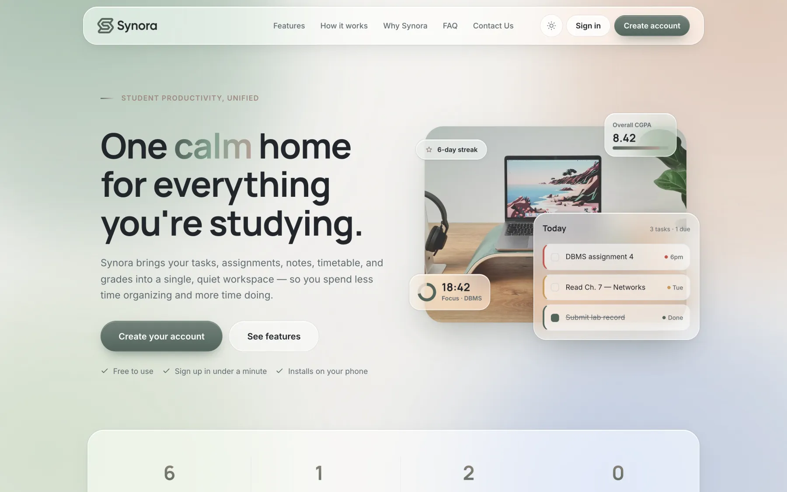
  </picture>
</a>

<sub>Screenshots follow your GitHub theme. Switch between light and dark to see both.</sub>

</div>

<br>

<div align="center">

**[What it is](#-what-is-synora)** ·
**[Features](#-features)** ·
**[Screens](#-a-tour-of-the-app)** ·
**[Architecture](#-architecture)** ·
**[Database](#-the-database)** ·
**[Design system](#-design-system)** ·
**[Run it](#-run-it-locally)** ·
**[Deployment](#-deployment)** ·
**[FAQ](#-faq)**

</div>

---

## ✦ What is Synora?

Academic life is scattered across fragmented tools: assignment deadlines lost in chat groups,
attendance percentages scribbled in notebooks, grades on buried spreadsheets, timetables saved as
gallery screenshots. When the pieces live apart, deadlines become Thursday-night surprises and
attendance drops below the cut-off before anyone notices.

**Synora brings it all into one calm workspace.** It answers *"What do I need to focus on today?"*
at a glance, with no ads, no subscriptions and no visual noise. The subject list sits at the centre:
the timetable, attendance, grades and tasks all point at it, so renaming a subject once updates it
everywhere.

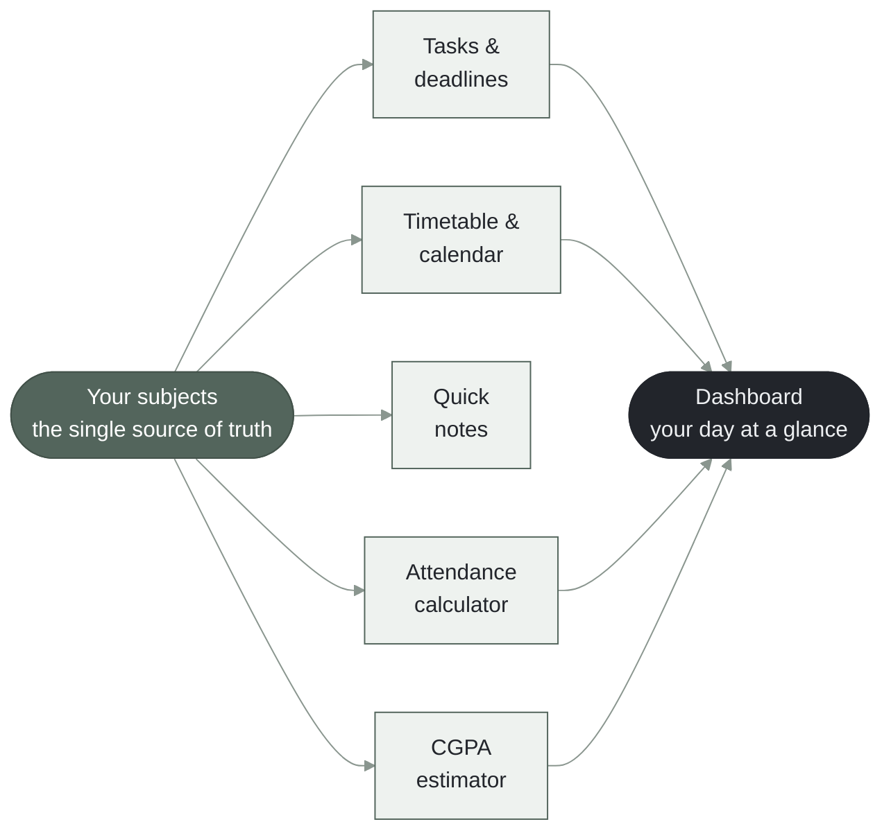

---

## ✦ Features

<table>
<tr>
<td width="50%" valign="top">

### 📋 Tasks & assignments
- Add, edit, complete and delete tasks with a subject, deadline, **4 priorities** (critical → low) and **3 statuses**.
- Grouped live into *Today*, *Upcoming*, *Overdue* and *Completed* from the real date, never a manual flag.
- Search as you type; sort by deadline, priority or newest.

</td>
<td width="50%" valign="top">

### 🗓️ Timetable & calendar
- A Monday–Sunday class grid with times, rooms and teachers. On phones it becomes stacked day cards.
- A monthly calendar with every deadline on its date. Tap a day to see it, or add a task straight to it.

</td>
</tr>
<tr>
<td valign="top">

### 🎓 CGPA estimator
- Credit-weighted on the 10-point scale: **CGPA = Σ(credits × grade point) ÷ Σ(credits)**.
- `O` 10 · `A+` 9 · `A` 8 · `B+` 7 · `B` 6, and three separate failure states, `E1` / `E2` / `E3` (0 points, credits still count).
- A split bar chart: passes rise above the line, failures drop below it.

</td>
<td valign="top">

### 📊 Attendance calculator
- One-tap **+ / −** for classes held and attended, per subject.
- Tells you exactly how many classes you can **safely miss**, or how many in a row you **must attend** to get back to your target (75% by default).
- Subjects can opt out of attendance and still count towards the CGPA.

</td>
</tr>
<tr>
<td valign="top">

### 📝 Quick notes
- Fast capture for formulas, checklists and lecture takeaways.
- Tagged by subject, filtered by a live search.

</td>
<td valign="top">

### 🏆 Achievements & 🔔 notifications
- **7 badges** that unlock as you work: *First Step*, *Getting Started*, *Productive*, *Consistent* (3-day streak), *Deadline Master*, *Academic Planner*, *Organized*.
- One notification centre for overdue and due-today tasks, attendance warnings and new badges.

</td>
</tr>
<tr>
<td valign="top">

### 🔐 Accounts that follow you
- Sign up once. Your workspace is saved in **MySQL** and loads on any browser or device.
- A **demo account** with a full semester of sample data, one click from the sign-in page.

</td>
<td valign="top">

### 🌓 Light & dark, phone to desktop
- Two hand-tuned themes from one set of design tokens, with no flash of the wrong theme on load.
- Fully responsive: the sidebar becomes a drawer at 900 px, with phone layouts below 560 px.

</td>
</tr>
</table>

---

## ✦ A tour of the app

The screens below come from the live app, signed in to the demo account.

<table>
<tr>
<td width="50%">
<picture>
  <source media="(prefers-color-scheme: dark)" srcset="docs/screenshots/dark/dashboard.webp">
  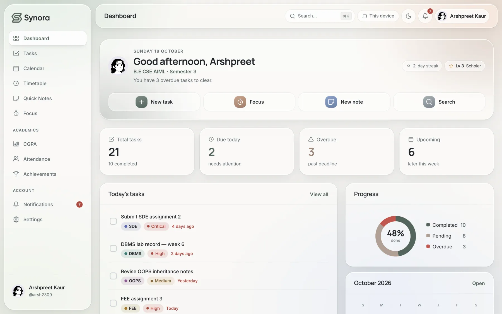
</picture>
<p align="center"><b>Dashboard</b>: greeting, streak, today's tasks, progress and calendar</p>
</td>
<td width="50%">
<picture>
  <source media="(prefers-color-scheme: dark)" srcset="docs/screenshots/dark/tasks.webp">
  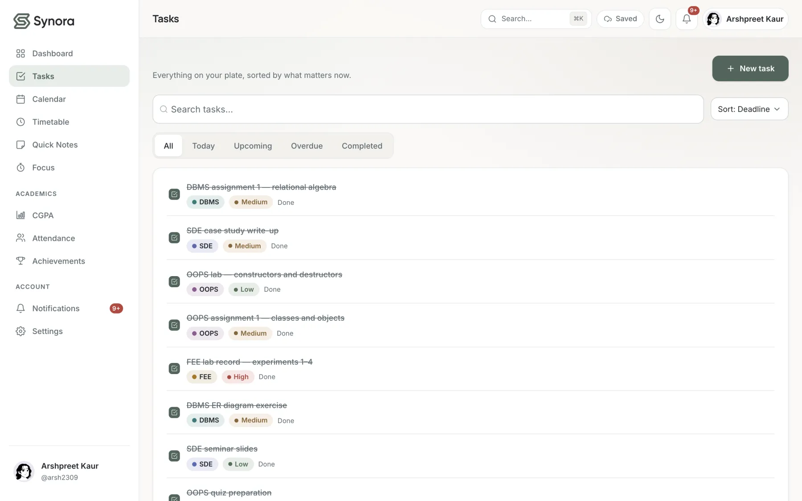
</picture>
<p align="center"><b>Tasks</b>: grouped by date, searchable, sorted by what matters</p>
</td>
</tr>
<tr>
<td>
<picture>
  <source media="(prefers-color-scheme: dark)" srcset="docs/screenshots/dark/timetable.webp">
  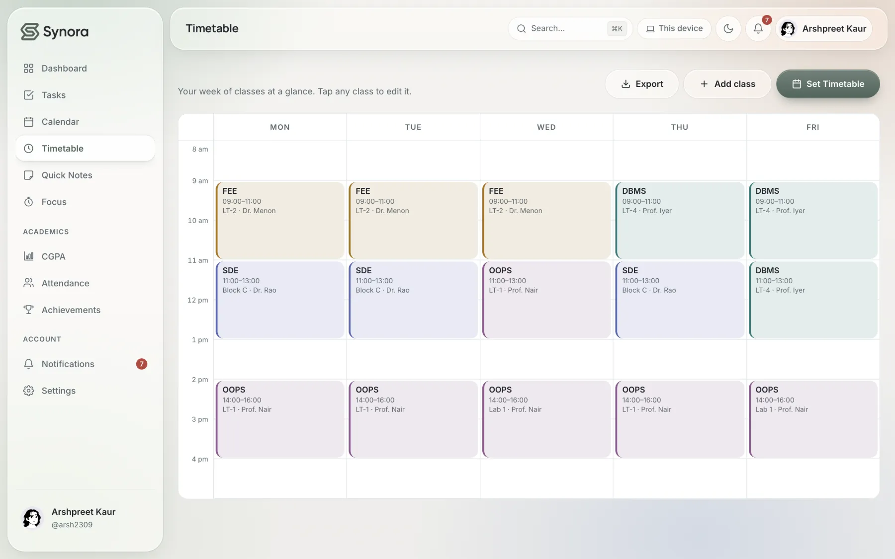
</picture>
<p align="center"><b>Timetable</b>: the week's classes with rooms and teachers</p>
</td>
<td>
<picture>
  <source media="(prefers-color-scheme: dark)" srcset="docs/screenshots/dark/calendar.webp">
  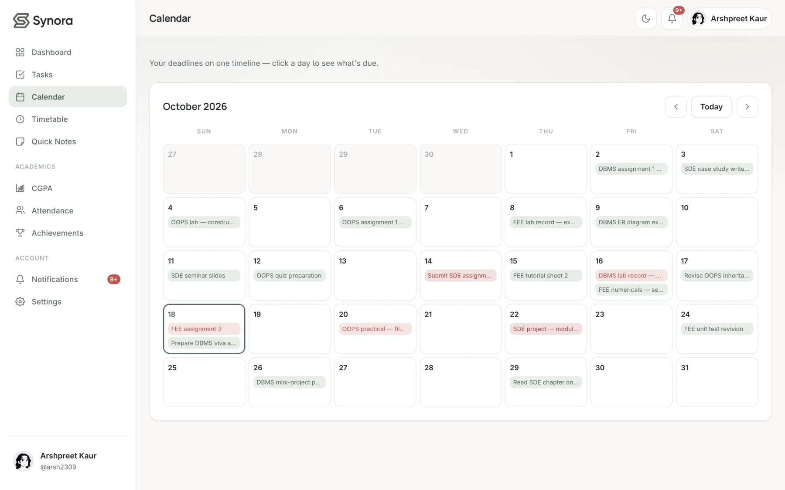
</picture>
<p align="center"><b>Calendar</b>: every deadline on its day</p>
</td>
</tr>
<tr>
<td>
<picture>
  <source media="(prefers-color-scheme: dark)" srcset="docs/screenshots/dark/cgpa.webp">
  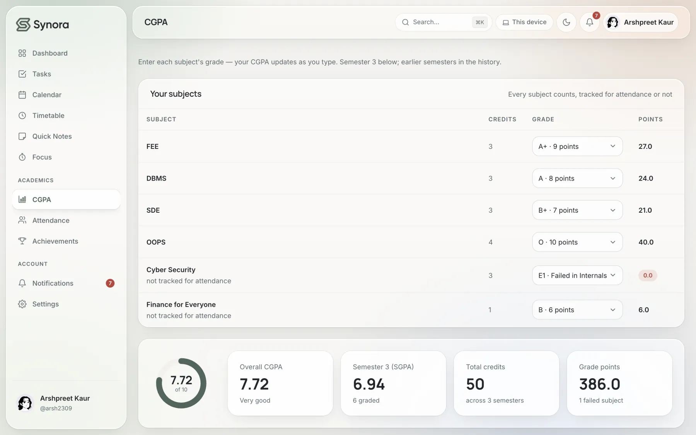
</picture>
<p align="center"><b>CGPA</b>: grades in, credit-weighted CGPA out</p>
</td>
<td>
<picture>
  <source media="(prefers-color-scheme: dark)" srcset="docs/screenshots/dark/attendance.webp">
  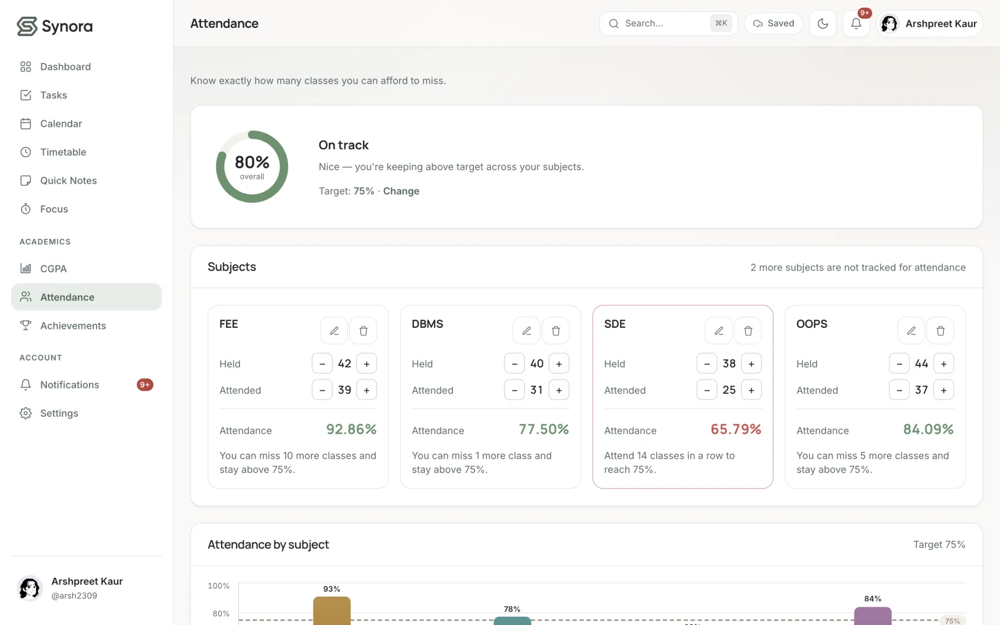
</picture>
<p align="center"><b>Attendance</b>: what you can miss, what you must attend</p>
</td>
</tr>
<tr>
<td>
<picture>
  <source media="(prefers-color-scheme: dark)" srcset="docs/screenshots/dark/notes.webp">
  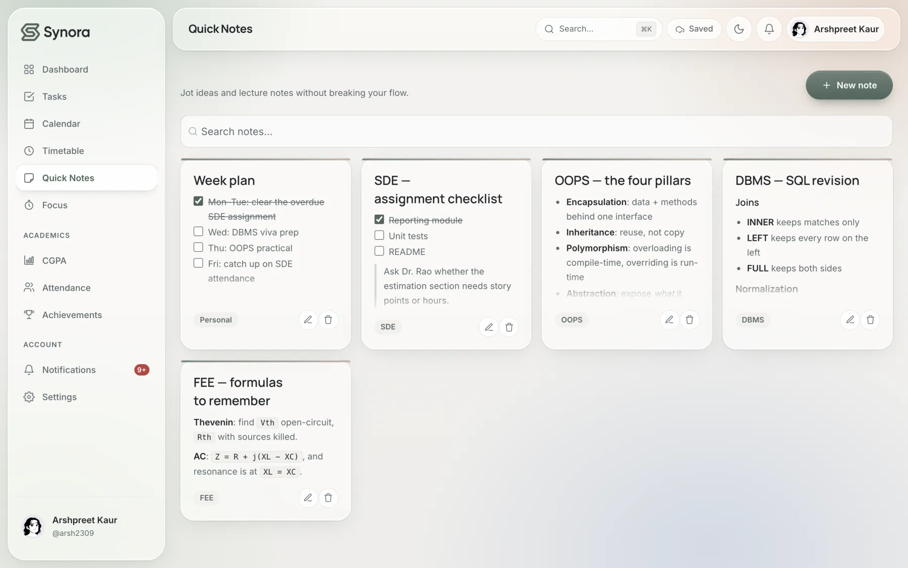
</picture>
<p align="center"><b>Quick notes</b>: per subject, searchable</p>
</td>
<td>
<picture>
  <source media="(prefers-color-scheme: dark)" srcset="docs/screenshots/dark/achievements.webp">
  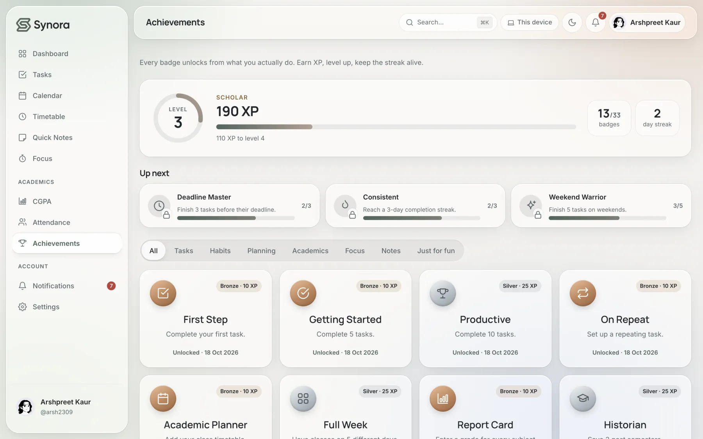
</picture>
<p align="center"><b>Achievements</b>: badges earned by actually studying</p>
</td>
</tr>
<tr>
<td>
<picture>
  <source media="(prefers-color-scheme: dark)" srcset="docs/screenshots/dark/onboarding.webp">
  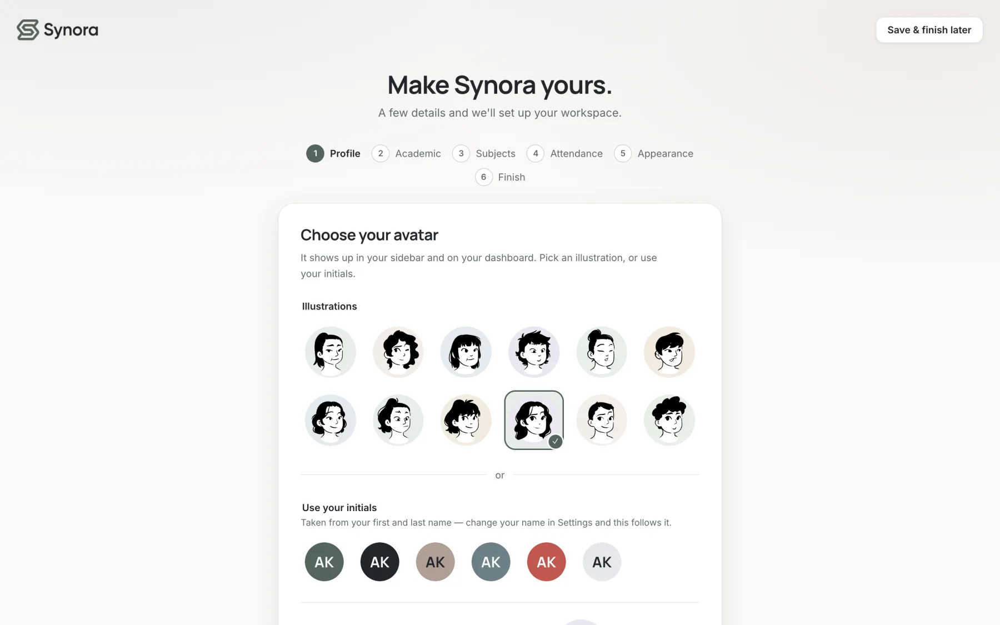
</picture>
<p align="center"><b>Onboarding</b>: six short steps to make it yours</p>
</td>
<td>
<picture>
  <source media="(prefers-color-scheme: dark)" srcset="docs/screenshots/dark/settings.webp">
  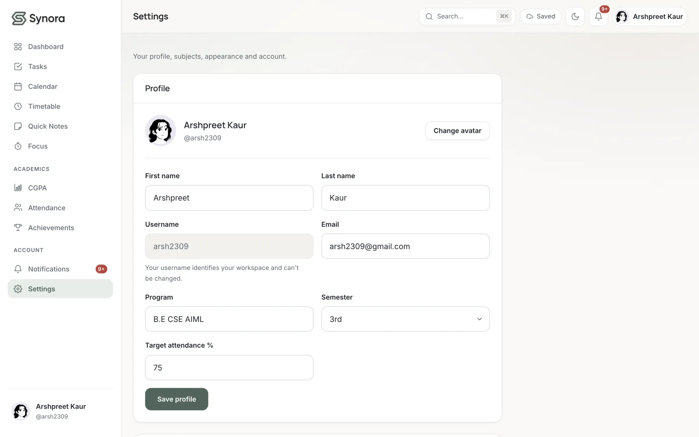
</picture>
<p align="center"><b>Settings</b>: profile, avatar, subjects and preferences</p>
</td>
</tr>
</table>

<details>
<summary><b>More screens</b>: sign-in and notifications</summary>
<br>
<table>
<tr>
<td width="50%">
<picture>
  <source media="(prefers-color-scheme: dark)" srcset="docs/screenshots/dark/login.webp">
  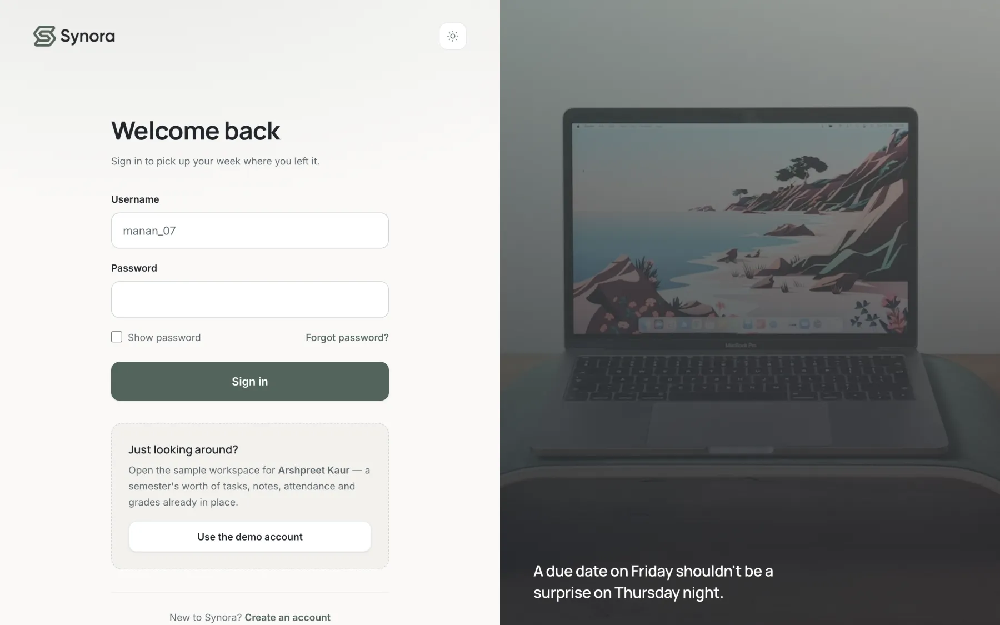
</picture>
<p align="center"><b>Sign in</b>, with the one-click demo account</p>
</td>
<td width="50%">
<picture>
  <source media="(prefers-color-scheme: dark)" srcset="docs/screenshots/dark/notifications.webp">
  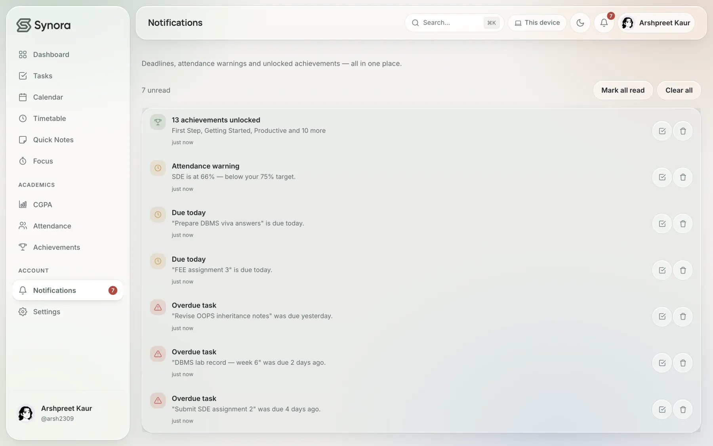
</picture>
<p align="center"><b>Notifications</b>: deadlines, attendance and badges in one place</p>
</td>
</tr>
</table>
</details>

### On your phone

<table>
<tr>
<td width="25%">
<picture>
  <source media="(prefers-color-scheme: dark)" srcset="docs/screenshots/dark/phone-dashboard.webp">
  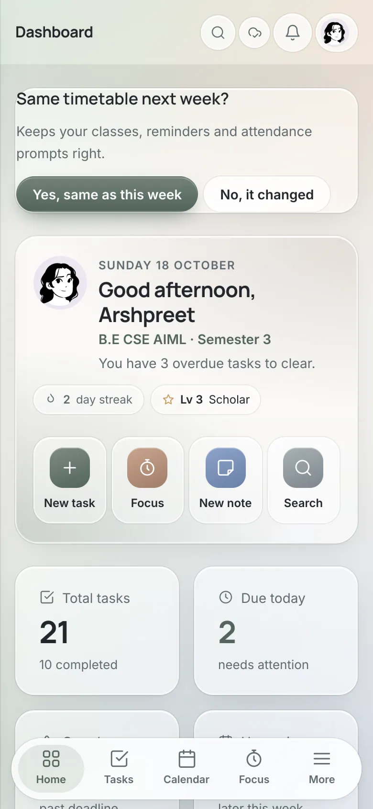
</picture>
</td>
<td width="25%">
<picture>
  <source media="(prefers-color-scheme: dark)" srcset="docs/screenshots/dark/phone-tasks.webp">
  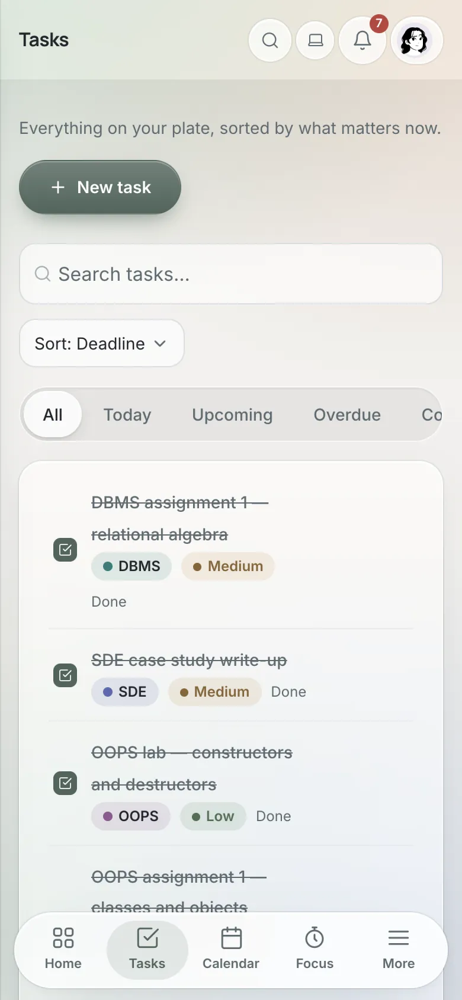
</picture>
</td>
<td width="25%">
<picture>
  <source media="(prefers-color-scheme: dark)" srcset="docs/screenshots/dark/phone-timetable.webp">
  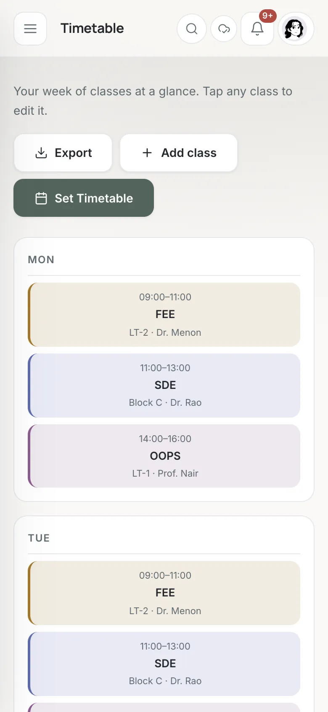
</picture>
</td>
<td width="25%">
<picture>
  <source media="(prefers-color-scheme: dark)" srcset="docs/screenshots/dark/phone-cgpa.webp">
  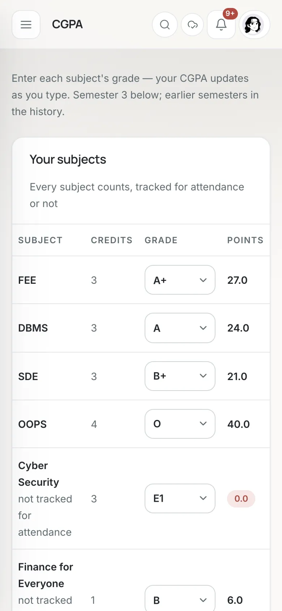
</picture>
</td>
</tr>
<tr>
<td align="center"><sub>Dashboard</sub></td>
<td align="center"><sub>Tasks</sub></td>
<td align="center"><sub>Timetable as day cards</sub></td>
<td align="center"><sub>CGPA with compact grades</sub></td>
</tr>
</table>

---

## ✦ How it works

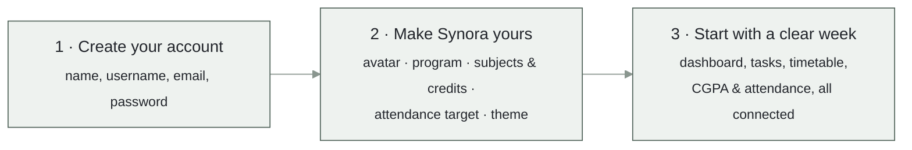

1. **Create your account.** It is stored in the database, so it works on every device.
2. **Make Synora yours.** A six-step onboarding: avatar (12 illustrations or initials), program and semester, subjects with credits, attendance target, theme, done.
3. **Start with a clear week.** Every page reads from the same subject list, so nothing has to be typed twice.

### Pages & routes

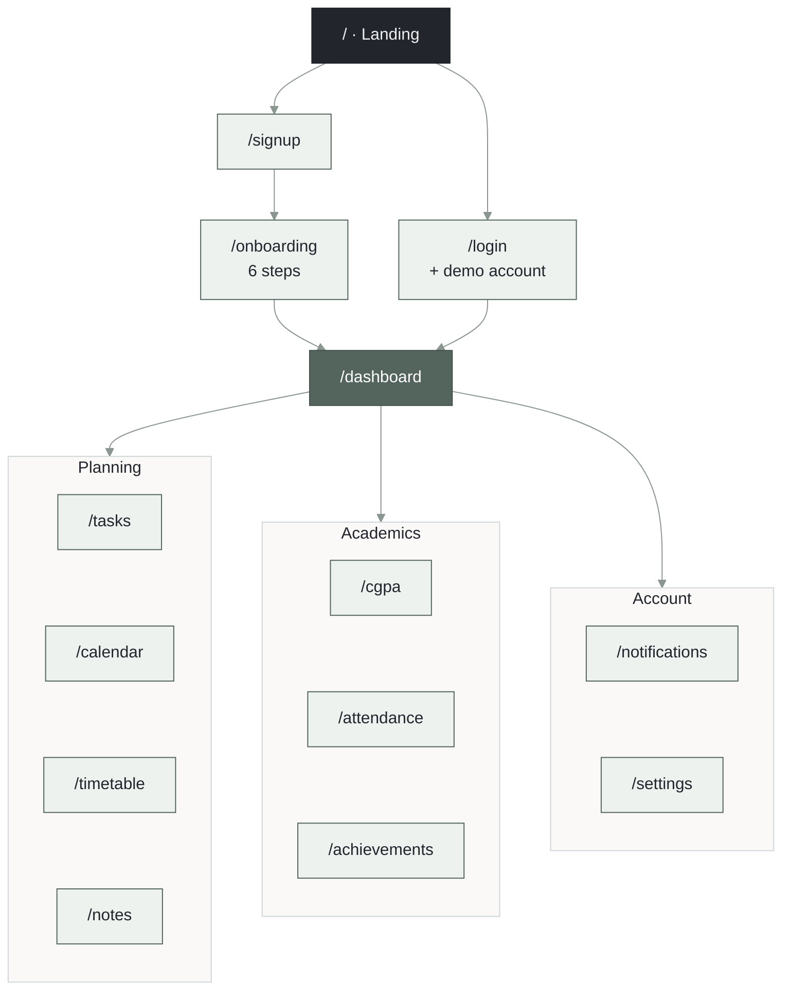

Any unknown URL redirects to `/`. Old links from the first, vanilla version (`/app/dashboard.html`
and so on) permanently redirect to their new routes.

---

## ✦ Architecture

Synora is a React single-page app with a small Express API next to it. On the live site both run
on **Vercel**: the app as a static build, the API as a serverless function. The data lives in a
**MySQL** database on **Aiven**.


| Layer | What it does | Where |
| :--- | :--- | :--- |
| **Pages** | One React component per route, styled with the design-system CSS | `src/pages/` |
| **Framework-free logic** | Tasks, grades, attendance maths, notifications & achievements engine, auth | `src/lib/` |
| **Store** | `localStorage` is the working copy. `useStore()` re-renders pages on every write (`useSyncExternalStore`) | `src/lib/storage.js` |
| **Sync** | Sends only what changed (items added, edited, deleted) and re-loads changes from other devices | `src/lib/sync.js` |
| **API** | Express routes for sign-up, sign-in, sign-out and saving / loading data | `server/app.js` |
| **Serverless entry** | Runs the same Express app as a Vercel function | `api/index.js` |
| **Database** | 13 MySQL tables (12 per-account + contact messages) | `database/schema.sql` |

### Every change, saved twice

The app always works from the browser copy, so pages open instantly and keep working if the
network drops. In the background, each change is mirrored into MySQL:

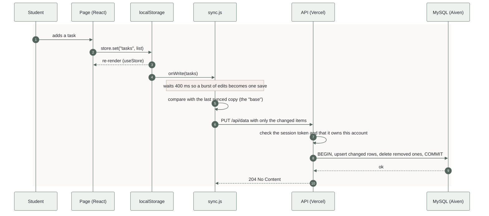

- **Only what changed:** each browser keeps a copy of what it last synced (the *base*) and sends just
  the difference. An item added on your phone is never deleted by a laptop that hasn't seen it yet.
- **Every device catches up:** the app re-loads from MySQL when it opens, when the tab comes back into
  view and every 2 minutes. It never overwrites edits that are still waiting to be saved.
- **Every tab stays current:** a second tab of the app re-renders as soon as the first one saves.
- **Always visible:** a small pill in the top bar shows *Saved*, *Saving…*, *Offline* (changes kept on
  this device and retried) or *This device* (not connected to an account database).
- **One transaction per save:** either every row lands or none does.
- **Never stuck:** a failed save retries with growing gaps (5 s up to 60 s). If the database can't be
  reached at all, the changes wait in the browser and upload as soon as it can be, with no need to sign in
  again.

### Signing in, and the password that never leaves the browser

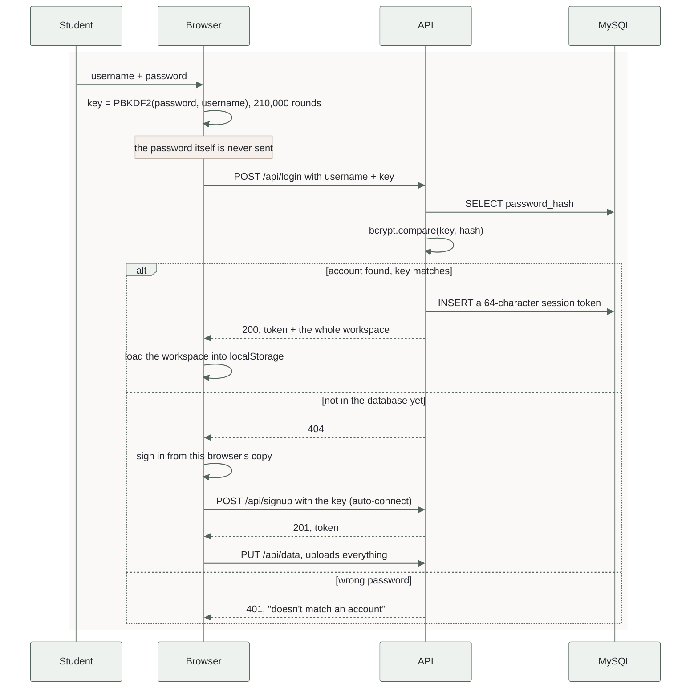

- The server stores only **`bcrypt(key)`**, never the password or the key itself. The key is
  PBKDF2-SHA256 salted with the username, so a leaked key is slow to turn back into a password.
- **Signing out** of a database account removes its key and workspace from that browser. On a
  shared computer, the next person finds nothing. Changes that couldn't be saved yet stay until the next
  sign-in uploads them.
- Each browser session token is tied to its account, and the API refuses (`409`) a save addressed to a
  different account.
- **Auto-connect:** while someone is signed in without a database session (a cold start, the
  database powered off, an expired token), the app retries on load, every 30 seconds, and when the tab
  comes back into view. It links the account the moment it can.

---

## ✦ The database

Thirteen tables in a database called `synora`. Twelve hold the accounts and their workspaces: every
row belongs to a user (`user_id`), and deleting an account deletes everything it owns (`ON DELETE
CASCADE`). The thirteenth, `contact_messages`, stores what people send through the landing page's
*Get in Touch* form. Full setup guide (Aiven →
MySQL Workbench → Vercel): **[`database/README.md`](database/README.md)**.

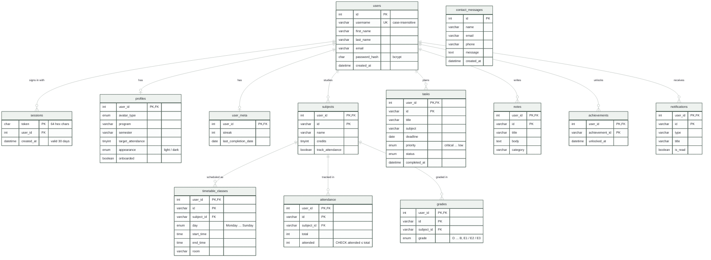

<details>
<summary><b>Ready-made SQL</b>: CGPA computed in the database</summary>
<br>

[`database/queries.sql`](database/queries.sql) has eleven queries to run in MySQL Workbench: every
account, rows per user, attendance against the target, overdue tasks, the weekly timetable, unread
notifications, who is signed in, contact-form messages, and this one, which works out the CGPA in SQL:

```sql
SELECT u.username,
       SUM(s.credits) AS total_credits,
       ROUND(SUM(s.credits * CASE g.grade
               WHEN 'O' THEN 10 WHEN 'A+' THEN 9 WHEN 'A' THEN 8
               WHEN 'B+' THEN 7 WHEN 'B' THEN 6 ELSE 0 END)
             / SUM(s.credits), 2) AS cgpa
FROM grades g
JOIN subjects s ON s.user_id = g.user_id AND s.id = g.subject_id
JOIN users u    ON u.id = g.user_id
WHERE g.grade IS NOT NULL
GROUP BY u.username;
```

</details>

---

## ✦ Design system

Everything is built from one set of CSS custom properties in [`src/styles/tokens.css`](src/styles/tokens.css):
colour, type, spacing, radii, shadows and motion. Each token has a light and a dark value. A tiny
inline script in `index.html` applies the saved theme before the first paint, so there is never a
flash of the wrong one.

<picture>
  <source media="(prefers-color-scheme: dark)" srcset="docs/brand/palette-dark.svg">
  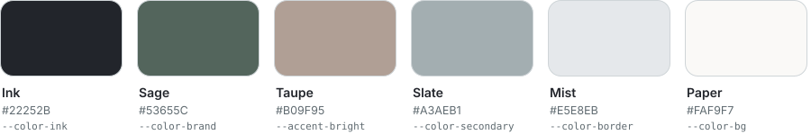
</picture>

| | Light | Dark | Used for |
| :--- | :--- | :--- | :--- |
| **Brand · sage** | `#53655C` | `#8FA697` | primary buttons, active navigation, focus |
| **Accent · taupe** | `#B09F95` | `#C6B4A9` | warm highlights, badges |
| **Ink** | `#22252B` | `#E8EAED` | headings and body text |
| **Muted** | `#5F6A70` | `#9CA5AC` | secondary text |
| **Border · mist** | `#E5E8EB` | `#2C3138` | dividers, card edges |
| **Background** | `#FAF9F7` | `#16181C` | the page itself |

- **Type:** *Manrope* for headings, *Inter* for everything else.
- **Principles:** calm by design (soft tones, generous whitespace, no red-badge panic); one source of
  truth (the subject list); private by default (no ads, no tracking cookies, hashed passwords).
- **Accessible:**
  - **0 violations** in an axe accessibility scan of every page, in both themes, including colour contrast;
  - semantic landmarks and a *Skip to content* link;
  - every input has a real `<label>` and its own error message;
  - dialogs trap focus and close with `Escape`;
  - `prefers-reduced-motion` respected (the splash loader shortens from 2 s to 0.6 s).

---

## ✦ Tech stack

| | |
| :--- | :--- |
| **UI** | React 19 (function components and hooks), React Router 8 |
| **Build** | Vite 8 |
| **Styling** | Hand-written CSS with design tokens: no framework, no UI kit |
| **API** | Node.js + Express 5, `mysql2` (connection pool, TLS), `bcryptjs` |
| **Database** | MySQL on Aiven (cloud), or any local MySQL 8+ |
| **Hosting** | Vercel: static build, serverless API, Web Analytics |
| **Runtime dependencies** | `react`, `react-dom`, `react-router` in the app, and `express`, `mysql2`, `bcryptjs` in the API. Nothing else. |

---

## ✦ Project structure

```text
Synora/
├── index.html              # HTML shell: fonts, pre-paint theme script, analytics
├── vite.config.js          # Vite build; proxies /api to the local API
├── vercel.json             # SPA rewrite, /api routing, redirects, asset caching
├── start.sh / start.bat    # One-click launchers (app + API)
│
├── api/
│   └── index.js            # Vercel serverless function → server/app.js
├── server/                 # The API
│   ├── app.js              # Routes: health, signup, login, logout, data
│   ├── collections.js      # The app's collections ⇄ table rows
│   ├── db.js               # MySQL pool (TLS for the cloud), transactions
│   └── index.js            # Runs the API locally (npm run server)
├── database/
│   ├── schema.sql          # Creates the `synora` database and its 13 tables
│   ├── local-user.sql      # The API's login on a local MySQL
│   ├── queries.sql         # Ready-made queries for MySQL Workbench
│   └── README.md           # Setup guide: Aiven, Workbench, Vercel
│
├── public/                 # Favicons, copied as-is
├── docs/                   # README screenshots and brand images
└── src/
    ├── main.jsx            # Entry: router, sync, auto-connect
    ├── App.jsx             # Route table
    ├── pages/              # One component per route (landing, auth, onboarding, …)
    ├── layouts/            # App shell: sidebar, topbar, auth layout
    ├── components/         # Shared UI: dialogs, toasts, icons, avatar picker, …
    ├── hooks/              # useStore, useTheme, usePageStyles, …
    ├── lib/                # Framework-free logic: storage, sync, api, auth, engine, …
    ├── data/               # Navigation items, avatar definitions
    ├── styles/             # tokens · base · components · landing · auth · onboarding · app
    └── assets/             # Logos, 12 avatars, landing imagery
```

---

## ✦ Run it locally

You need **Node.js 22.22+**.

```bash
git clone https://github.com/Manan-2007/Synora.git
cd Synora
npm install
npm run dev            # http://localhost:5173
```

Or run **`./start.sh`** (macOS / Linux) or double-click **`start.bat`** (Windows). It installs what's
missing, starts everything and opens the browser.

> **Try it:** click **Create account** for the full onboarding, or **Sign in → Use the demo account**
> for a workspace already full of a semester's tasks, grades, attendance and notes.

**With a database:** without one, the app runs on browser storage alone. To save to MySQL while
developing, create `server/.env` (pointing at the cloud database, or a local MySQL set up with
`database/schema.sql` + `database/local-user.sql`). `./start.sh` then starts the API too. See
[`database/README.md`](database/README.md), part 5.

| Command | |
| :--- | :--- |
| `npm run dev` | the app with hot reload |
| `npm run server` | the API on `127.0.0.1:4000` (reads `server/.env`) |
| `npm run build` | production build into `dist/` |
| `npm run preview` | serve the production build |

---

## ✦ Deployment

The live site deploys automatically from `main` on **Vercel**.

- Vercel builds the app with Vite and serves `dist/`. `api/index.js` becomes a serverless function.
- [`vercel.json`](vercel.json) sends `/api/*` to that function and every other path to `index.html`, so deep links like `/dashboard` work on refresh.
- It also permanently redirects old `/app/*.html` links, and caches hashed assets for a year.
- The database connection comes only from Vercel's environment variables (`DB_HOST`, `DB_PASSWORD`, `DB_SSL_CA`, …), never from the repository.
- Until those variables are set, `/api/health` answers *no database* and the site runs on browser storage.
- Security headers on every response:
  - a strict **Content-Security-Policy** (scripts only from the site itself);
  - `X-Frame-Options: DENY` (no clickjacking);
  - `X-Content-Type-Options: nosniff`, `Referrer-Policy` and `Permissions-Policy`.
- Sign-ups are capped per address and for the whole site per hour.

---

## ✦ FAQ

<details>
<summary><b>Is Synora free?</b></summary>
<br>Yes. No paid tier, no trial, no ads, nothing locked behind an upgrade.
</details>

<details>
<summary><b>Where is my data stored?</b></summary>
<br>In Synora's MySQL database, linked to your account, so signing in anywhere brings your workspace
with you. A copy also lives in your browser so every page opens instantly. Passwords are stored only as
bcrypt hashes.
</details>

<details>
<summary><b>What is the demo account?</b></summary>
<br>A sample student, Arshpreet Kaur, with a full semester of tasks, timetable, grades, attendance and
notes. It is one shared account: anyone who uses it on the live site sees the same workspace. It resets
itself to fresh sample data once a day, so its deadlines always look current.
</details>

<details>
<summary><b>Does it work on my phone?</b></summary>
<br>Yes. Every page is responsive. Sign in with the same account and your workspace is already there.
</details>

<details>
<summary><b>What happens if the database is down?</b></summary>
<br>Nothing visible. The app keeps working from the browser copy and uploads everything as soon as the
database is back, without asking you to sign in again.
</details>

---

## ✦ Roadmap

- [ ] **Calendar export:** timetable and deadlines as an `.ics` file
- [ ] **Syllabus tracker:** topic-by-topic progress inside each subject
- [ ] **Reminders:** browser push notifications for high-priority deadlines
- [ ] **Contact form delivery:** send *Get in touch* messages by email
- [ ] **Demo reset:** restore the shared demo account to its sample data automatically

---

<div align="center">

<picture>
  <source media="(prefers-color-scheme: dark)" srcset="src/assets/logo-mark-dark.png">
  
</picture>

**Synora**: *Organize · Focus · Progress*

<sub>Built as a student project with care for calm, focused studying.</sub>

</div>
