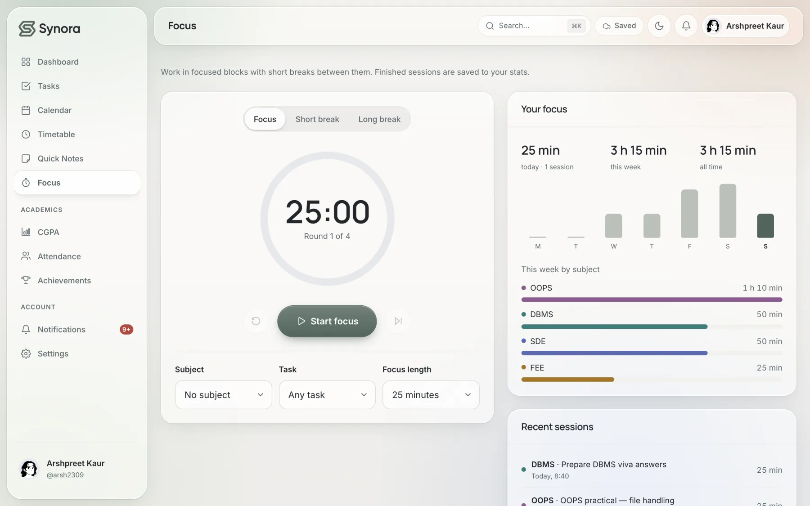
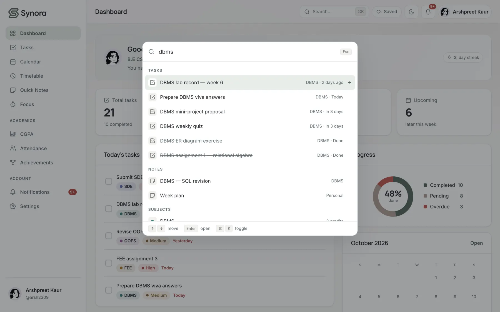
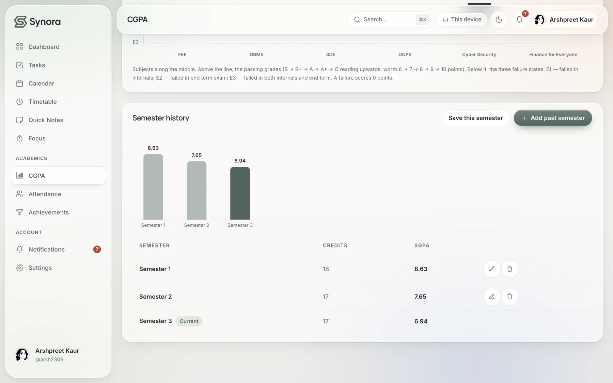
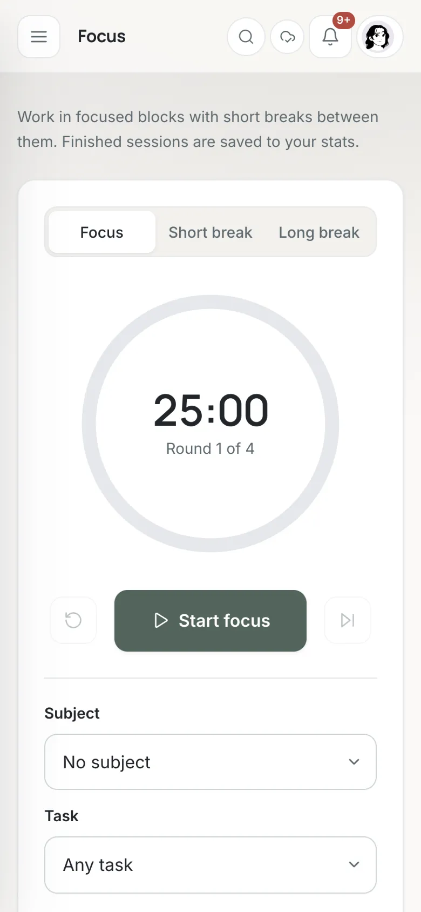
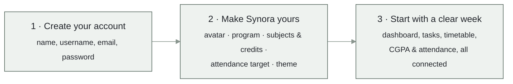
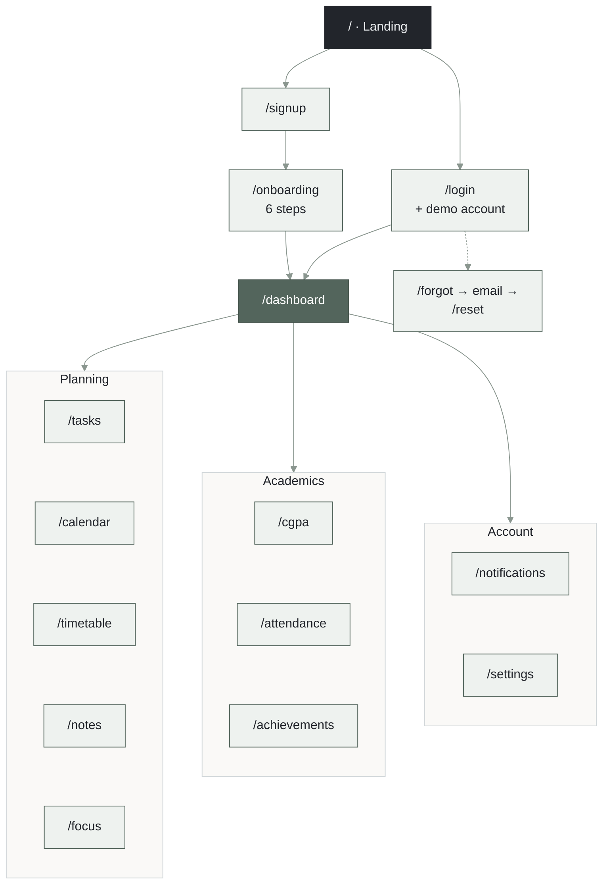
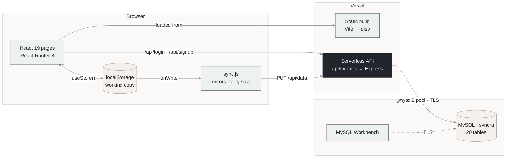
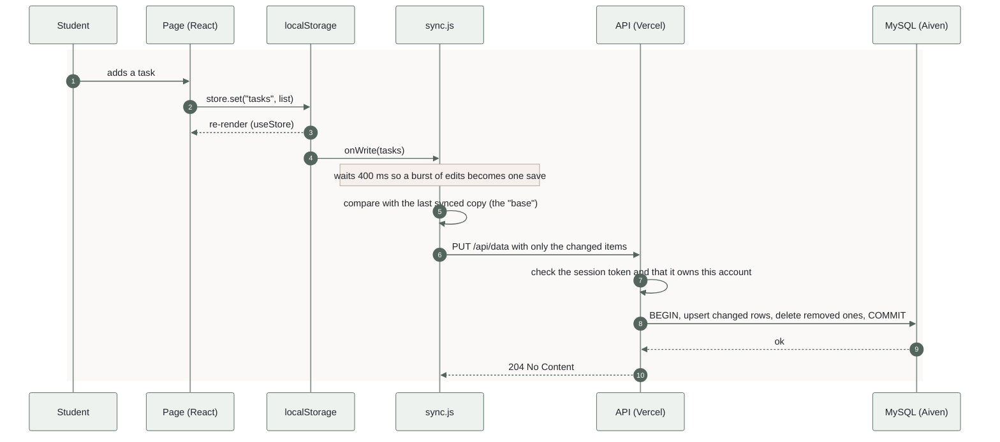
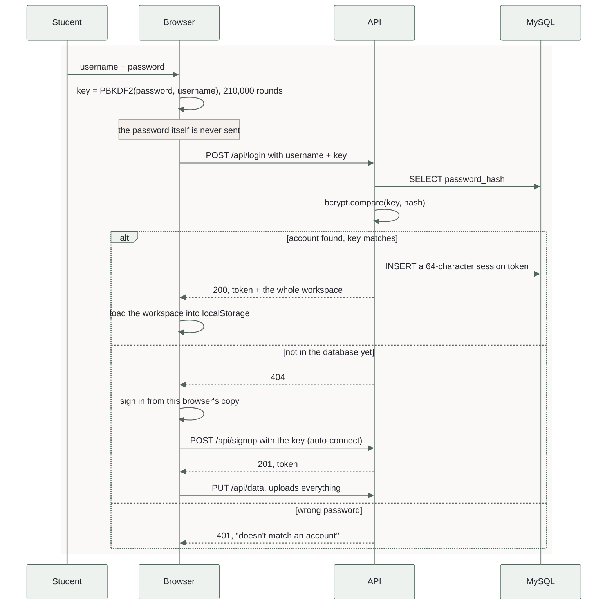

<div align="center">

<a href="https://synora-v1.vercel.app/">
  <picture>
    <source media="(prefers-color-scheme: dark)" srcset="src/assets/logo-lockup-dark.png">
    
  </picture>
</a>

### One calm home for everything you're studying.

Tasks, timetable, notes, a focus timer, CGPA, attendance and achievements, in a single quiet workspace.

<br>

[](https://synora-v1.vercel.app/)
&nbsp;
[](https://synora-v1.vercel.app/login)

[](https://react.dev/)
[](https://vite.dev/)
[](https://reactrouter.com/)
[](https://expressjs.com/)
[](database/README.md)
[](https://synora-v1.vercel.app/)
[](#-design-system)

<br>

<a href="https://synora-v1.vercel.app/">
  <picture>
    <source media="(prefers-color-scheme: dark)" srcset="docs/screenshots/dark/landing.webp">
    
  </picture>
</a>

<sub>Screenshots follow your GitHub theme. Switch between light and dark to see both.</sub>

</div>

<br>

<div align="center">

**[What it is](#-what-is-synora)** ·
**[Features](#-features)** ·
**[Screens](#-a-tour-of-the-app)** ·
**[Architecture](#-architecture)** ·
**[Database](#-the-database)** ·
**[Design system](#-design-system)** ·
**[Run it](#-run-it-locally)** ·
**[Deployment](#-deployment)** ·
**[FAQ](#-faq)**

</div>

---

## ✦ What is Synora?

Academic life is scattered across fragmented tools: assignment deadlines lost in chat groups,
attendance percentages scribbled in notebooks, grades on buried spreadsheets, timetables saved as
gallery screenshots. When the pieces live apart, deadlines become Thursday-night surprises and
attendance drops below the cut-off before anyone notices.

**Synora brings it all into one calm workspace.** It answers *"What do I need to focus on today?"*
at a glance, with no ads, no subscriptions and no visual noise. The subject list sits at the centre:
the timetable, attendance, grades and tasks all point at it, so renaming a subject once updates it
everywhere.


---

## ✦ Features

<table>
<tr>
<td width="50%" valign="top">

### 📋 Tasks & assignments
- Subject, deadline, **4 priorities** (critical → low) and **3 statuses**, grouped live into *Today*, *Upcoming*, *Overdue* and *Completed*.
- **Repeating tasks** (daily, weekly, monthly): finish one and the next is queued for you.
- A **checklist** inside any task, tickable straight from the list.
- **Attach photos, PDFs and documents**: a photo of the board, the assignment sheet.

</td>
<td width="50%" valign="top">

### 🗓️ Timetable & calendar
- **Scan your timetable:** take a photo (or pick a PDF) and Synora reads every class, for you to check before it's saved. At the end of each week it asks whether next week's is the same.
- A real week board: classes sized by their times, a line for *now*, and a colour for every subject. Day cards on phones.
- A **month or week** calendar with every deadline and class on its day.
- **Export to your calendar** as an `.ics` file (Google, Apple, Outlook): deadlines plus weekly classes.

</td>
</tr>
<tr>
<td valign="top">

### 🎓 CGPA across semesters
- Credit-weighted on the 10-point scale: **Σ(credits × grade point) ÷ Σ(credits)**, with `E1` / `E2` / `E3` failures at 0 points.
- **Semester history:** SGPA for every semester, a trend chart, and the **overall CGPA** across all of them.
- **"What grade do I need?"**: type a target CGPA and see the average you need in the subjects still ungraded.
- **What if?**: try grades for this semester and watch the SGPA and overall CGPA move, without saving.

</td>
<td valign="top">

### 📊 Attendance calculator
- One-tap **+ / −** per subject, and exactly how many classes you can **safely miss** or **must attend** to reach your target.
- **"Did you attend?"**: after each class in your timetable, the dashboard asks, and so does a notification (Attended / Missed buttons). One tap updates the count, **by the hour**: a 2-hour lab counts as 2 classes, the way colleges count attendance.
- Subjects can opt out of attendance and still count towards the CGPA.

</td>
</tr>
<tr>
<td valign="top">

### 📝 Notes in Markdown
- `**bold**`, *italics*, headings, lists, code and links, rendered safely (no HTML is ever injected).
- `- [ ]` checklists that tick right from the note card. Write / Preview while editing.
- Photos and files attached to any note.

</td>
<td valign="top">

### ⏱️ Focus timer
- Pomodoro blocks (15–60 min) with short and long breaks, for a subject and a task.
- Keeps running across pages and reloads, with a countdown in the top bar.
- Finished sessions are saved: today, this week, minutes per subject.

</td>
</tr>
<tr>
<td valign="top">

### ⌘ Search everything
- **⌘K / Ctrl+K** (or the search box) finds tasks, notes, subjects and pages, and runs actions like *New task*.
- Fully keyboard-driven: ↑ ↓ to move, Enter to open.

</td>
<td valign="top">

### 🔔 Reminders, badges & notifications
- **Reminders** before each class, a "Did you attend?" after it, and each morning for what's due, **even with Synora closed** (push notifications; on iPhone, from the home-screen app).
- **33 badges** in bronze, silver and gold, earning XP and levels, with *Up next* showing what's closest. One notification centre for deadlines, attendance and badges.

</td>
</tr>
<tr>
<td valign="top">

### 🔐 Accounts that follow you
- Your workspace is saved in **MySQL** and loads on any device. Open the site again and you're straight back in your dashboard.
- Change your password, **reset it by email**, or delete the account and everything in it.
- A **demo account** with a full semester of sample data, one click from the sign-in page.

</td>
<td valign="top">

### 📱 Installable, glassy, light & dark
- **Install it** like an app (home screen or dock, with step-by-step help on iPhone). It opens instantly and works offline.
- A frosted-glass, iOS-style look in two hand-tuned themes, with a floating tab bar on phones.
- A *Get started* checklist, a short **tour** on first sign-in, and friendly illustrations whenever a page is empty.
- Loads fast: each page is fetched on demand (the first visit downloads about a quarter of the code).

</td>
</tr>
</table>

---

## ✦ A tour of the app

The screens below come from the live app, signed in to the demo account.

<table>
<tr>
<td width="50%">
<picture>
  <source media="(prefers-color-scheme: dark)" srcset="docs/screenshots/dark/dashboard.webp">
  
</picture>
<p align="center"><b>Dashboard</b>: greeting, streak, today's tasks, progress and calendar</p>
</td>
<td width="50%">
<picture>
  <source media="(prefers-color-scheme: dark)" srcset="docs/screenshots/dark/tasks.webp">
  
</picture>
<p align="center"><b>Tasks</b>: grouped by date, with repeats and checklists</p>
</td>
</tr>
<tr>
<td>
<picture>
  <source media="(prefers-color-scheme: dark)" srcset="docs/screenshots/dark/timetable.webp">
  
</picture>
<p align="center"><b>Timetable</b>: the week board, or scan it from a photo</p>
</td>
<td>
<picture>
  <source media="(prefers-color-scheme: dark)" srcset="docs/screenshots/dark/calendar.webp">
  
</picture>
<p align="center"><b>Calendar</b>: month or week, exportable as <code>.ics</code></p>
</td>
</tr>
<tr>
<td>
<picture>
  <source media="(prefers-color-scheme: dark)" srcset="docs/screenshots/dark/cgpa.webp">
  
</picture>
<p align="center"><b>CGPA</b>: grades in, credit-weighted CGPA out</p>
</td>
<td>
<picture>
  <source media="(prefers-color-scheme: dark)" srcset="docs/screenshots/dark/attendance.webp">
  
</picture>
<p align="center"><b>Attendance</b>: what you can miss, what you must attend</p>
</td>
</tr>
<tr>
<td>
<picture>
  <source media="(prefers-color-scheme: dark)" srcset="docs/screenshots/dark/notes.webp">
  
</picture>
<p align="center"><b>Notes</b>: Markdown, with checklists that tick</p>
</td>
<td>
<picture>
  <source media="(prefers-color-scheme: dark)" srcset="docs/screenshots/dark/focus.webp">
  
</picture>
<p align="center"><b>Focus</b>: Pomodoro timer and where the week's time went</p>
</td>
</tr>
<tr>
<td>
<picture>
  <source media="(prefers-color-scheme: dark)" srcset="docs/screenshots/dark/search.webp">
  
</picture>
<p align="center"><b>⌘K search</b>: tasks, notes, subjects, pages and actions</p>
</td>
<td>
<picture>
  <source media="(prefers-color-scheme: dark)" srcset="docs/screenshots/dark/semesters.webp">
  
</picture>
<p align="center"><b>Semester history</b>: SGPA trend and overall CGPA</p>
</td>
</tr>
<tr>
<td>
<picture>
  <source media="(prefers-color-scheme: dark)" srcset="docs/screenshots/dark/achievements.webp">
  
</picture>
<p align="center"><b>Achievements</b>: 33 badges, XP and levels</p>
</td>
<td>
<picture>
  <source media="(prefers-color-scheme: dark)" srcset="docs/screenshots/dark/onboarding.webp">
  
</picture>
<p align="center"><b>Onboarding</b>: six short steps to make it yours</p>
</td>
</tr>
</table>

<details>
<summary><b>More screens</b>: sign-in, notifications and settings</summary>
<br>
<table>
<tr>
<td width="50%">
<picture>
  <source media="(prefers-color-scheme: dark)" srcset="docs/screenshots/dark/login.webp">
  
</picture>
<p align="center"><b>Sign in</b>, with the one-click demo account</p>
</td>
<td width="50%">
<picture>
  <source media="(prefers-color-scheme: dark)" srcset="docs/screenshots/dark/notifications.webp">
  
</picture>
<p align="center"><b>Notifications</b>: deadlines, attendance and badges in one place</p>
</td>
</tr>
<tr>
<td>
<picture>
  <source media="(prefers-color-scheme: dark)" srcset="docs/screenshots/dark/settings.webp">
  
</picture>
<p align="center"><b>Settings</b>: profile, subjects and colours, reminders, password</p>
</td>
<td></td>
</tr>
</table>
</details>

### On your phone

<table>
<tr>
<td width="20%">
<picture>
  <source media="(prefers-color-scheme: dark)" srcset="docs/screenshots/dark/phone-dashboard.webp">
  
</picture>
</td>
<td width="20%">
<picture>
  <source media="(prefers-color-scheme: dark)" srcset="docs/screenshots/dark/phone-tasks.webp">
  
</picture>
</td>
<td width="20%">
<picture>
  <source media="(prefers-color-scheme: dark)" srcset="docs/screenshots/dark/phone-timetable.webp">
  
</picture>
</td>
<td width="20%">
<picture>
  <source media="(prefers-color-scheme: dark)" srcset="docs/screenshots/dark/phone-cgpa.webp">
  
</picture>
</td>
<td width="20%">
<picture>
  <source media="(prefers-color-scheme: dark)" srcset="docs/screenshots/dark/phone-focus.webp">
  
</picture>
</td>
</tr>
<tr>
<td align="center"><sub>Dashboard</sub></td>
<td align="center"><sub>Tasks</sub></td>
<td align="center"><sub>Timetable as day cards</sub></td>
<td align="center"><sub>CGPA with compact grades</sub></td>
<td align="center"><sub>Focus timer</sub></td>
</tr>
</table>

---

## ✦ How it works



1. **Create your account.** It is stored in the database, so it works on every device.
2. **Make Synora yours.** A six-step onboarding: avatar (12 illustrations or initials), program and semester, subjects with credits, attendance target, theme, done.
3. **Start with a clear week.** Every page reads from the same subject list, so nothing has to be typed twice.

### Pages & routes



Opening the site while signed in skips the landing and sign-in pages and goes straight to
`/dashboard`. Any unknown URL redirects to `/`. Old links from the first, vanilla version
(`/app/dashboard.html` and so on) permanently redirect to their new routes.

---

## ✦ Architecture

Synora is a React single-page app with a small Express API next to it. On the live site both run
on **Vercel**: the app as a static build, the API as a serverless function. The data lives in a
**MySQL** database on **Aiven**.



| Layer | What it does | Where |
| :--- | :--- | :--- |
| **Pages** | One React component per route, styled with the design-system CSS | `src/pages/` |
| **Framework-free logic** | Tasks, grades, attendance maths, notifications & achievements engine, auth | `src/lib/` |
| **Store** | `localStorage` is the working copy. `useStore()` re-renders pages on every write (`useSyncExternalStore`) | `src/lib/storage.js` |
| **Sync** | Sends only what changed (items added, edited, deleted) and re-loads changes from other devices | `src/lib/sync.js` |
| **API** | Express routes for sign-up, sign-in, sign-out, password change / reset, account deletion, saving / loading data | `server/app.js` |
| **Self-upgrading schema** | Adds new tables and columns to an existing database on the first request after a deploy | `server/migrate.js` |
| **Serverless entry** | Runs the same Express app as a Vercel function | `api/index.js` |
| **Database** | 20 MySQL tables (19 per-account + contact messages) | `database/schema.sql` |
| **Push** | Stores push subscriptions; a scheduled call sends class and due-today reminders | `server/push.js` |
| **Timetable scan** | Sends a timetable photo or PDF to Google Gemini (or Claude) and returns the classes it lists | `server/scan.js` |
| **Offline & install** | Web app manifest and a service worker that caches the app shell | `public/sw.js` |

### Every change, saved twice

The app always works from the browser copy, so pages open instantly and keep working if the
network drops. In the background, each change is mirrored into MySQL:



- **Only what changed:** each browser keeps a copy of what it last synced (the *base*) and sends just
  the difference. An item added on your phone is never deleted by a laptop that hasn't seen it yet.
- **Every device catches up:** the app re-loads from MySQL when it opens, when the tab comes back into
  view and every 2 minutes. It never overwrites edits that are still waiting to be saved.
- **Every tab stays current:** a second tab of the app re-renders as soon as the first one saves.
- **Always visible:** a small pill in the top bar shows *Saved*, *Saving…*, *Offline* (changes kept on
  this device and retried) or *This device* (not connected to an account database).
- **One transaction per save:** either every row lands or none does.
- **Never stuck:** a failed save retries with growing gaps (5 s up to 60 s). If the database can't be
  reached at all, the changes wait in the browser and upload as soon as it can be, with no need to sign in
  again.

### Signing in, and the password that never leaves the browser



- The server stores only **`bcrypt(key)`**, never the password or the key itself. The key is
  PBKDF2-SHA256 salted with the username, so a leaked key is slow to turn back into a password.
- **Signing out** of a database account removes its key and workspace from that browser. On a
  shared computer, the next person finds nothing. Changes that couldn't be saved yet stay until the next
  sign-in uploads them.
- Each browser session token is tied to its account, and the API refuses (`409`) a save addressed to a
  different account.
- **Forgot your password?** `/forgot` emails a one-time link (via Brevo) that expires after 30
  minutes. Only a SHA-256 hash of the link's token is stored, and using it signs out every device.
  The page never says whether an account exists.
- **Auto-connect:** while someone is signed in without a database session (a cold start, the
  database powered off, an expired token), the app retries on load, every 30 seconds, and when the tab
  comes back into view. It links the account the moment it can.

---

## ✦ The database

Twenty tables in a database called `synora`. Nineteen hold the accounts and their workspaces: every
row belongs to a user (`user_id`), and deleting an account deletes everything it owns (`ON DELETE
CASCADE`). The twentieth, `contact_messages`, stores what people send through the landing page's
*Get in Touch* form. New tables and columns reach an existing database by themselves: the API adds
whatever is missing on its first request after a deploy (`server/migrate.js`). Full setup guide (Aiven →
MySQL Workbench → Vercel): **[`database/README.md`](database/README.md)**.

```mermaid
%%{init: {"theme": "base", "themeVariables": {"fontFamily": "Inter, -apple-system, Segoe UI, sans-serif", "primaryColor": "#EEF2EF", "primaryTextColor": "#22252B", "primaryBorderColor": "#53655C", "lineColor": "#8A968F", "attributeBackgroundColorOdd": "#FFFFFF", "attributeBackgroundColorEven": "#FAF9F7", "relationLabelBackground": "#FFFFFF", "relationLabelColor": "#22252B"}}}%%
erDiagram
    users ||--o{ sessions : "signs in with"
    users ||--o| profiles : has
    users ||--o| user_meta : has
    users ||--o{ subjects : studies
    users ||--o{ tasks : plans
    users ||--o{ notes : writes
    users ||--o{ achievements : unlocks
    users ||--o{ notifications : receives
    users ||--o{ semesters : completed
    semesters ||--o{ semester_grades : contains
    users ||--o{ focus_sessions : focuses
    users ||--o{ password_resets : "may request"
    users ||--o{ attachments : "attaches files"
    users ||--o{ push_subscriptions : "gets pushes on"
    users ||--o{ push_sent : "was reminded"
    subjects ||--o{ timetable_classes : "scheduled as"
    subjects ||--o{ attendance : "tracked in"
    subjects ||--o{ grades : "graded in"

    users {
        int id PK
        varchar username UK "case-insensitive"
        varchar first_name
        varchar last_name
        varchar email
        char password_hash "bcrypt"
        datetime created_at
    }
    sessions {
        char token PK "64 hex chars"
        int user_id FK
        datetime created_at "valid 30 days"
    }
    profiles {
        int user_id PK, FK
        enum avatar_type
        varchar program
        varchar semester
        tinyint target_attendance
        enum appearance "light / dark"
        boolean onboarded
    }
    user_meta {
        int user_id PK, FK
        int streak
        date last_completion_date
        boolean checklist_dismissed
    }
    subjects {
        int user_id PK, FK
        varchar id PK
        varchar name
        tinyint credits
        boolean track_attendance
        varchar color
    }
    tasks {
        int user_id PK, FK
        varchar id PK
        varchar title
        varchar subject
        date deadline
        enum priority "critical … low"
        enum status
        enum repeat_rule "none / daily / weekly / monthly"
        json subtasks "the checklist"
        datetime completed_at
    }
    notes {
        int user_id PK, FK
        varchar id PK
        varchar title
        text body
        varchar category
    }
    timetable_classes {
        int user_id PK, FK
        varchar id PK
        varchar subject_id FK
        enum day "Monday … Sunday"
        time start_time
        time end_time
        varchar room
        date last_marked "attendance asked"
    }
    attendance {
        int user_id PK, FK
        varchar id PK
        varchar subject_id FK
        int total
        int attended "CHECK attended ≤ total"
    }
    grades {
        int user_id PK, FK
        varchar id PK
        varchar subject_id FK
        enum grade "O … B, E1 / E2 / E3"
    }
    achievements {
        int user_id PK, FK
        varchar achievement_id PK
        datetime unlocked_at
    }
    notifications {
        int user_id PK, FK
        varchar id PK
        varchar type
        varchar title
        boolean is_read
    }
    semesters {
        int user_id PK, FK
        varchar id PK
        varchar name
    }
    semester_grades {
        int user_id PK, FK
        varchar id PK
        varchar semester_id FK
        varchar name
        tinyint credits
        enum grade
    }
    focus_sessions {
        int user_id PK, FK
        varchar id PK
        varchar subject_id
        smallint minutes
        datetime ended_at
    }
    password_resets {
        char token_hash PK "SHA-256"
        int user_id FK
        datetime expires_at "30 minutes"
    }
    attachments {
        int user_id PK, FK
        varchar id PK
        enum owner_type "task / note"
        varchar owner_id
        varchar name
        varchar mime
        mediumblob data "up to 3.5 MB"
    }
    push_subscriptions {
        char id PK "SHA-256 of endpoint"
        int user_id FK
        text endpoint
        varchar tz "the browser's time zone"
    }
    push_sent {
        int user_id PK, FK
        varchar key PK "class:<id>:<date>"
        datetime sent_at
    }
    contact_messages {
        int id PK
        varchar name
        varchar email
        varchar phone
        text message
        datetime created_at
    }
```



<details>
<summary><b>Ready-made SQL</b>: CGPA computed in the database</summary>
<br>

[`database/queries.sql`](database/queries.sql) has eleven queries to run in MySQL Workbench: every
account, rows per user, attendance against the target, overdue tasks, the weekly timetable, unread
notifications, who is signed in, contact-form messages, and this one, which works out the CGPA in SQL:

```sql
SELECT u.username,
       SUM(s.credits) AS total_credits,
       ROUND(SUM(s.credits * CASE g.grade
               WHEN 'O' THEN 10 WHEN 'A+' THEN 9 WHEN 'A' THEN 8
               WHEN 'B+' THEN 7 WHEN 'B' THEN 6 ELSE 0 END)
             / SUM(s.credits), 2) AS cgpa
FROM grades g
JOIN subjects s ON s.user_id = g.user_id AND s.id = g.subject_id
JOIN users u    ON u.id = g.user_id
WHERE g.grade IS NOT NULL
GROUP BY u.username;
```

</details>

---

## ✦ Design system

Everything is built from one set of CSS custom properties in [`src/styles/tokens.css`](src/styles/tokens.css):
colour, type, spacing, radii, shadows and motion. Each token has a light and a dark value. A tiny
inline script in `index.html` applies the saved theme before the first paint, so there is never a
flash of the wrong one.

<picture>
  <source media="(prefers-color-scheme: dark)" srcset="docs/brand/palette-dark.svg">
  
</picture>

| | Light | Dark | Used for |
| :--- | :--- | :--- | :--- |
| **Brand · sage** | `#53655C` | `#8FA697` | primary buttons, active navigation, focus |
| **Accent · taupe** | `#B09F95` | `#C6B4A9` | warm highlights, badges |
| **Ink** | `#22252B` | `#E8EAED` | headings and body text |
| **Muted** | `#5F6A70` | `#9CA5AC` | secondary text |
| **Border · mist** | `#E5E8EB` | `#2C3138` | dividers, card edges |
| **Background** | `#FAF9F7` | `#16181C` | the page itself |

- **Type:** *Manrope* for headings, *Inter* for everything else.
- **Principles:** calm by design (soft tones, generous whitespace, no red-badge panic); one source of
  truth (the subject list); private by default (no ads, no tracking cookies, hashed passwords).
- **Accessible:**
  - **0 violations** in an axe accessibility scan of every page, in both themes, including colour contrast;
  - semantic landmarks and a *Skip to content* link;
  - every input has a real `<label>` and its own error message;
  - dialogs trap focus and close with `Escape`;
  - `prefers-reduced-motion` respected (the splash loader shortens from 2 s to 0.6 s).

### The glass look

Since October 2026 Synora wears an iOS-style **frosted glass** finish, built from a second set of
tokens (`--glass-*` and `--app-ambient` in `tokens.css`):

- **A colour wash behind everything:** soft sage, taupe, blue and mint glows fixed under the page
  (and slowly drifting on the landing page), so translucent panels have something to frost.
- **Glass panels:** cards, the sidebar, top bar, dialogs, menus and toasts are translucent
  (`--glass-bg`), blur what's behind them (`backdrop-filter: blur(24px) saturate(180%)`), and carry a
  bright top edge, a hairline and a long soft shadow.
- **Capsules:** buttons, segmented controls, chips and the phone tab bar are pill-shaped; primary
  buttons have a gentle top-to-bottom gradient.
- **Floating chrome:** on wide screens the sidebar and top bar float inside the page; on phones a glass
  tab bar floats above the content and toasts drop in from the top like iOS banners.
- **Readable first:** the same contrast rules apply (axe scans stay at 0 violations), and a blur never
  sits inside another blur (menus inside the frosted top bar are nearly solid instead).

---

## ✦ Tech stack

| | |
| :--- | :--- |
| **UI** | React 19 (function components and hooks), React Router 8 |
| **Build** | Vite 8 |
| **Styling** | Hand-written CSS with design tokens: no framework, no UI kit |
| **API** | Node.js + Express 5, `mysql2` (connection pool, TLS), `bcryptjs` |
| **Database** | MySQL on Aiven (cloud), or any local MySQL 8+ |
| **Hosting** | Vercel (Mumbai region, next to the database): static build, serverless API, Web Analytics |
| **Email** | Brevo's transactional API, for password-reset links (one `fetch`, no SDK) |
| **Quality** | ESLint (React hooks rules) and a GitHub Actions check (lint + build) on every push |
| **AI** | Google Gemini (free tier) or Claude reads timetable photos and PDFs, server-side |
| **Push** | Web Push with VAPID (`web-push`), scheduled by GitHub Actions and Vercel cron |
| **Runtime dependencies** | `react`, `react-dom`, `react-router` in the app, and `express`, `mysql2`, `bcryptjs`, `web-push` in the API. Nothing else. |

---

## ✦ Project structure

```text
Synora/
├── index.html              # HTML shell: fonts, pre-paint theme script, analytics
├── vite.config.js          # Vite build; proxies /api to the local API
├── vercel.json             # SPA rewrite, /api routing, redirects, headers, region
├── eslint.config.js        # Lint rules (npm run lint)
├── .github/workflows/      # CI: lint + build on every push
├── start.sh / start.bat    # One-click launchers (app + API)
│
├── api/
│   └── index.js            # Vercel serverless function → server/app.js
├── server/                 # The API
│   ├── app.js              # Routes: health, signup, login, logout, password, account, data
│   ├── collections.js      # The app's collections ⇄ table rows
│   ├── migrate.js          # Adds new tables / columns to an existing database
│   ├── db.js               # MySQL pool (TLS for the cloud), transactions
│   └── index.js            # Runs the API locally (npm run server)
├── database/
│   ├── schema.sql          # Creates the `synora` database and its 20 tables
│   ├── local-user.sql      # The API's login on a local MySQL
│   ├── queries.sql         # Ready-made queries for MySQL Workbench
│   └── README.md           # Setup guide: Aiven, Workbench, Vercel
│
├── public/                 # Icons, web app manifest, service worker (sw.js)
├── docs/                   # README screenshots and brand images
└── src/
    ├── main.jsx            # Entry: router, sync, auto-connect
    ├── App.jsx             # Route table
    ├── pages/              # One component per route (landing, auth, onboarding, …)
    ├── layouts/            # App shell: sidebar, topbar, auth layout
    ├── components/         # Shared UI: dialogs, toasts, icons, avatar picker, …
    ├── hooks/              # useStore, useTheme, usePageStyles, …
    ├── lib/                # Framework-free logic: storage, sync, api, auth, engine, …
    ├── data/               # Navigation items, avatar definitions
    ├── styles/             # tokens · base · components · landing · auth · onboarding · app
    └── assets/             # Logos, 12 avatars, landing imagery
```

---

## ✦ Run it locally

You need **Node.js 22.22+**.

```bash
git clone https://github.com/Manan-2007/Synora.git
cd Synora
npm install
npm run dev            # http://localhost:5173
```

Or run **`./start.sh`** (macOS / Linux) or double-click **`start.bat`** (Windows). It installs what's
missing, starts everything and opens the browser.

> **Try it:** click **Create account** for the full onboarding, or **Sign in → Use the demo account**
> for a workspace already full of a semester's tasks, grades, attendance and notes.

**With a database:** without one, the app runs on browser storage alone. To save to MySQL while
developing, create `server/.env` (pointing at the cloud database, or a local MySQL set up with
`database/schema.sql` + `database/local-user.sql`). `./start.sh` then starts the API too. See
[`database/README.md`](database/README.md), part 5.

| Command | |
| :--- | :--- |
| `npm run dev` | the app with hot reload |
| `npm run server` | the API on `127.0.0.1:4000` (reads `server/.env`) |
| `npm run build` | production build into `dist/` |
| `npm run lint` | ESLint over the app, the API and the service worker |
| `npm run preview` | serve the production build |

---

## ✦ Deployment

The live site deploys automatically from `main` on **Vercel**.

- Vercel builds the app with Vite and serves `dist/`. `api/index.js` becomes a serverless function.
- [`vercel.json`](vercel.json) sends `/api/*` to that function and every other path to `index.html`, so deep links like `/dashboard` work on refresh.
- It also permanently redirects old `/app/*.html` links, and caches hashed assets for a year.
- The database connection comes only from Vercel's environment variables (`DB_HOST`, `DB_PASSWORD`, `DB_SSL_CA`, …), never from the repository.
- The API runs in Vercel's Mumbai region (`bom1`), a ~20 ms round trip from the Aiven database.
- New tables and columns are added to the live database automatically after a deploy.
- Password-reset emails need `BREVO_API_KEY` and `MAIL_FROM` (a sender verified in Brevo). Without them, *Forgot password?* says email isn't set up yet. See [`database/README.md`](database/README.md#6-password-reset-emails-brevo).
- Push reminders need `VAPID_PUBLIC_KEY`, `VAPID_PRIVATE_KEY` and `CRON_SECRET` in Vercel, and the same `CRON_SECRET` as a GitHub repository secret (for the 10-minute schedule in `.github/workflows/push-tick.yml`). See [part 7](database/README.md#7-push-reminders-with-synora-closed).
- Timetable scanning needs `GEMINI_API_KEY` (free, from Google AI Studio) or `ANTHROPIC_API_KEY`. See [part 8](database/README.md#8-timetable-from-a-photo-gemini-free).
- Every one of these is optional: without its keys a feature says it isn't set up, and everything else works.
- Until those variables are set, `/api/health` answers *no database* and the site runs on browser storage.
- Security headers on every response:
  - a strict **Content-Security-Policy** (scripts only from the site itself);
  - `X-Frame-Options: DENY` (no clickjacking);
  - `X-Content-Type-Options: nosniff`, `Referrer-Policy` and `Permissions-Policy`.
- Sign-ups are capped per address and for the whole site per hour.

---

## ✦ FAQ

<details>
<summary><b>Is Synora free?</b></summary>
<br>Yes. No paid tier, no trial, no ads, nothing locked behind an upgrade.
</details>

<details>
<summary><b>Where is my data stored?</b></summary>
<br>In Synora's MySQL database, linked to your account, so signing in anywhere brings your workspace
with you. A copy also lives in your browser so every page opens instantly. Passwords are stored only as
bcrypt hashes.
</details>

<details>
<summary><b>What is the demo account?</b></summary>
<br>A sample student, Arshpreet Kaur, with a full semester of tasks, timetable, grades, attendance and
notes. It is one shared account: anyone who uses it on the live site sees the same workspace. It resets
itself to fresh sample data once a day, so its deadlines always look current.
</details>

<details>
<summary><b>Does it work on my phone?</b></summary>
<br>Yes. Every page is responsive. Sign in with the same account and your workspace is already there.
</details>

<details>
<summary><b>Can I install it like an app?</b></summary>
<br>Yes. In Chrome or Edge use <b>Install Synora</b> (or Settings → <i>Install the app</i>); on an iPhone,
Safari's <b>Share → Add to Home Screen</b>. It opens full screen, straight into your workspace, and loads
offline from its own copy.
</details>

<details>
<summary><b>I forgot my password.</b></summary>
<br>Use <b>Forgot password?</b> on the sign-in page. If the account has an email address, a link to set a
new password arrives within a minute and works for 30 minutes.
</details>

<details>
<summary><b>Do reminders work when Synora is closed?</b></summary>
<br>Yes, once you turn reminders on in Settings: the server pushes them to your device. On an iPhone or
iPad that works from the home-screen app (Safari's Share → Add to Home Screen), then turn reminders on
inside it.
</details>

<details>
<summary><b>What happens if the database is down?</b></summary>
<br>Nothing visible. The app keeps working from the browser copy and uploads everything as soon as the
database is back, without asking you to sign in again.
</details>

---

## ✦ Roadmap

- [x] **Calendar export:** timetable and deadlines as an `.ics` file
- [x] **Reminders** while the app is open: classes and what's due today
- [x] **Demo reset:** the shared demo account restores its sample data every day
- [x] **Semesters, focus timer, ⌘K search, Markdown notes, installable app**
- [x] **Push reminders** that arrive with the app closed (Web Push)
- [x] **Attachments, timetable from a photo, what-if grades, first-run tour, glass design**
- [ ] **Syllabus tracker:** topic-by-topic progress inside each subject
- [ ] **Contact form delivery:** send *Get in touch* messages by email
- [ ] **Data export:** download your whole workspace as a file

---

<div align="center">

<picture>
  <source media="(prefers-color-scheme: dark)" srcset="src/assets/logo-mark-dark.png">
  
</picture>

**Synora**: *Organize · Focus · Progress*

<sub>Built as a student project with care for calm, focused studying.</sub>

</div>
